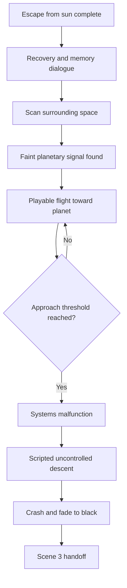

# SPACE RAT — Scene 2: The Signal

## Purpose
A direct continuation of Scene 1, after the pilot narrowly avoids the sun. Move from survival and confusion to a new objective: follow a faint signal toward a nearby planet. End with an unavoidable but cinematic crash landing that sets up Scene 3.

**Tone:** mysterious science fiction; dialogue follows the standing rule — **sharp, funny, sarcastic** pilot, deadpan computer with the occasional dry jab. **Target first prototype:** 5–8 minutes. **Design principle:** make the flight toward the planet playable; keep the final loss of control and crash scripted.

## Decisions (2026-11-15) — these override conflicting text below
- **Transition:** separate Unity scene `Scene02_TheSignal`. Scene 1 fades to the SPACE RAT title card; Scene 2 loads with the ship placed near the escaped sun.
- **Dialogue:** auto-timed like Scene 1 (Space skips in dev). Lines during flight/crash never wait for input. Same `DialogueSequence` ScriptableObjects and dialogue panel as Scene 1.
- **Flight failure:** none. Drifting off course triggers sarcastic computer nags and the bearing marker pulls attention back; heading back toward the sun only gets a warning.
- **Flight length:** ~2–3 minutes at normal speed (boost shortens it). Fill it with tutorial beats, banter, signal-distortion moments and optional asteroid scenery (bumps = shake + dry remark, no damage).
- **Controls:** W = nose down / S = nose up (flight-sim; invert option later), A/D yaw, Q/E roll, ↑/↓ throttle, hold Shift boost. Scene 1 uses the same pitch convention.
- **Crash ending:** cockpit atmospheric-entry fire → exterior shot of the ship falling → hard cut to black on impact → "Pilot? ... Please respond." No terrain needed in V1.
- **Cinematics:** keep Scene 1's director pattern (state machine + coroutines); Timeline only for the crash if it helps.
- **Assets:** planet + atmosphere from Simple Space Starter Kit (Atmosphere/Star shadergraphs); skybox from SpaceSkies Free; ship = **blue Sparrow** (same as Scene 1). Asteroid pack (`Plans/Links.txt`) optional.
- **Ownership:** Claude builds all of Scene 2; Codex is used separately for UI polish on Claude's recommendations (overrides the Codex section below).
- **Scene 3 note:** the pilot wakes after the crash on foot — that's where the full-body first-person humanoid controller comes in.

## Scene outline

### 1. After the escape — breathing room
- The ship stabilises gradually; alarm volume fades and emergency lights remain active.
- Camera settles into the pilot's first-person cockpit view, using the transparent cockpit overlay so Unity renders space through the windshield.
- Engine hum and damaged electrical systems remain audible. Dialogue appears in the established portrait-left, text-right bottom panel.
- Do not reveal the pilot's name or origin.

**Dialogue (editable draft)** — opens on Scene 1's last exchange ("Now tell me who I am." / "I am unable to answer that question." / "Of course you are."), so don't re-ask identity head-on.

**PILOT:** Okay. Not on fire. Small wins.

**COMPUTER:** Hull temperature returning to survivable levels.

**PILOT:** "Survivable." Love the bar we're setting.

**PILOT:** Fine. Forget who I am. Where are we?

**COMPUTER:** Current position unknown. Navigation database inaccessible.

**PILOT:** So you don't know who I am, where we are, or why we're here.

**COMPUTER:** That is an accurate summary.

**PILOT:** Fantastic. What *do* you know?

**COMPUTER:** We were recently on a collision course with a star.

**PILOT:** Yeah, I was there for that part.

**COMPUTER:** I appear to have initialised shortly before the collision warning. My earlier operational history is also missing.

**PILOT:** So we both just woke up.

**COMPUTER:** That is a reasonable hypothesis. I cannot verify it.

**PILOT:** Great. Two amnesiacs in a broken spaceship. Sounds like the start of a bad joke.

**COMPUTER:** I do not know any jokes. That data is also missing.

**PILOT:** Somehow that's the saddest thing you've said.

### 2. Search for help
- Pilot requests a scan; a scanning effect plays across the cockpit radar.
- Several seconds of static, then a faint, intermittent transmission is detected.
- HUD shows an uncertain bearing and a planet contact; the computer cannot identify the planet or decode the signal.

**PILOT:** Scan the area. Anything that helps us not die.

**COMPUTER:** Initiating passive scan. Sensors operating below nominal capacity.

**PILOT:** Join the club.

**COMPUTER:** ...One signal detected. Extremely weak. Origin: a nearby planetary body.

**PILOT:** A distress beacon?

**COMPUTER:** Unknown. It may be artificial. It may also be interference.

**PILOT:** "Maybe help, maybe static." Still better odds than the star. Can we get there?

**COMPUTER:** Warp drive offline. Conventional thrusters available, with limitations.

**PILOT:** Of course they are. Mark the bearing.

**COMPUTER:** Bearing marked. I recommend avoiding further stellar encounters.

**PILOT:** Wow. Wish I'd thought of that.

### 3. Playable flight — follow the signal
- The player steers the ship toward the target marker and accelerates using conventional engines.
- The destination planet becomes progressively larger; an intermittent signal-strength indicator increases as the ship approaches.
- A short tutorial introduces steering, throttle and **temporary speed boost**.
- Warp drive remains disabled throughout. Boost is a brief conventional-engine overdrive, not faster-than-light travel.
- Optional mid-flight dialogue reveals that the ship's memory loss is broader than a damaged navigation database.

**Tutorial beats**

**COMPUTER:** Thruster overdrive available. Hold Shift. Do not hold it forever.

**PILOT:** What happens if I hold it forever?

**COMPUTER:** It stops. Then you are disappointed.

**Optional exchanges (spread across the 2–3 minute flight)**

**PILOT:** Any idea what wiped our memories?

**COMPUTER:** No. The missing records are remarkably thorough.

**PILOT:** That's not reassuring.

**COMPUTER:** It was not intended to be.

**PILOT:** So... got any music in there?

**COMPUTER:** Audio archives missing.

**PILOT:** Of course they are.

**COMPUTER:** I can play the collision alarm.

**PILOT:** Please don't.

**COMPUTER:** Signal strength increasing. We are approaching the source.

**PILOT:** Finally, good news. Write that down. Oh wait — you can't.

**Off-course nags (computer, randomised, rate-limited)**
- "The planet is the other way. The large, round one."
- "You are drifting off course. Recalculating my opinion of you."
- "The glowing marker is the destination. I added it specifically for you."
- (toward the sun) "We have already tried the star. I did not enjoy it."

**Asteroid bump (optional)**
- **COMPUTER:** "Minor impact. Please stop hitting rocks." · **PILOT:** "The rock hit *me*."

### 4. Malfunction near the planet
- At a designer-defined approach threshold, ship warning indicators flicker and the signal spikes or briefly distorts.
- A power surge disables steering and destabilises the engines; the player loses control **as an intentional story event**, not because they failed the flight section.
- The computer warns of cascading failures. Planet gravity pulls the ship into an uncontrolled descent.

**COMPUTER:** Warning. Uncommanded power fluctuation.

**PILOT:** Oh, come ON.

**COMPUTER:** Flight controls are no longer responding. Engine output unstable.

**PILOT:** Give me manual override!

**COMPUTER:** Manual override unavailable.

**PILOT:** You said we could make it!

**COMPUTER:** I said we could attempt to reach the planet.

**PILOT:** This is a terrible time to be precise!

**COMPUTER:** Atmospheric entry imminent. Brace for impact.

**PILOT:** Bracing! Whatever that means!

### 5. Crash landing — end of scene
- Transition from player-controlled approach to a scripted cinematic.
- Cockpit shakes; alarms, sparks and atmospheric glow intensify. Brief exterior camera shot shows the ship falling toward the planet.
- The ship hits terrain, skids or bounces, and comes to rest in dust and smoke. Use camera shake and audio rather than requiring complex destruction physics in V1.
- Fade to black on impact, then a few seconds of near-silence.
- Optional final line from the damaged computer: **“Pilot? ... Please respond.”**
- End Scene 2; Scene 3 begins with the pilot waking after the crash.

## Controls — suggested PC defaults

| Action | Default | Behaviour |
|---|---|---|
| Pitch | W / S | Nose down / up; configurable inversion |
| Yaw | A / D | Steer left / right |
| Roll | Q / E | Roll ship |
| Throttle up / down | Up / Down arrows | Change forward thrust |
| Boost | Left Shift (hold) | Temporary speed increase while energy remains |
| Dialogue skip (dev) | Space | Dialogue is auto-timed; Space skips the current line |
| Pause | Escape | Pause and show controls |

Use Unity Input System actions and rebindable bindings, not hard-coded key polling. Keep control behaviour consistent with Scene 1 where possible. Support keyboard initially; gamepad later.

## Boost system — prototype tuning
- Boost is **conventional thruster overdrive**; warp drive stays offline.
- Suggested starting values, all Inspector-configurable: boost speed multiplier **1.6x**, maximum continuous boost **4 seconds**, full recharge **8 seconds**.
- Display a simple boost energy bar and a brief engine/audio response.
- Prevent boost while the ship is in the scripted crash sequence.
- Tune travel distance and boost availability to make the planet journey interesting without excessive empty flight.

## HUD and presentation
- Reuse Scene 1's transparent cockpit artwork as an overlay; render the 3D sun, starfield and planet behind its windshield.
- Reuse the bottom dialogue panel: left portrait (pilot or computer), speaker label, right text, optional voice and typewriter effect.
- Add a target bearing marker, distance-to-target, signal strength, speed, boost energy and system status.
- Keep UI readable at 16:9 and avoid covering the centre of the windshield.
- Show **WARP DRIVE: OFFLINE** as a status indicator, not an available action.
- Use restrained visual effects for signal detection; preserve mystery rather than revealing the source.

## Unity implementation structure

Suggested responsibilities (adapt to existing project architecture):

- `Scene2Director`: state machine for Recovery → Conversation → Scan → Travel → Approach → Malfunction → Crash → Complete.
- `DialogueSequenceController`: reusable data-driven dialogue; speaker portraits and optional voice clips.
- `ShipFlightController`: player flight input and conventional propulsion, reused from Scene 1.
- `ShipBoostController`: energy, cooldown, speed multiplier, UI events.
- `SignalScanner`: timed scan sequence and signal-bearing/strength presentation.
- `PlanetApproachTrigger`: starts malfunction when the target approach condition is met.
- `ShipFailureSequence`: disables flight input and runs staged failures.
- `CrashCinematicController`: cameras, animation/timeline, sound, fade and scene handoff.
- `Scene2HUD`: status readouts and tutorial prompts.

Prefer serialized references, ScriptableObject dialogue data, Cinemachine cameras and Timeline for cinematics where available. Use event-driven transitions rather than timing everything in one monolithic script. Avoid introducing packages without checking project compatibility.

### State flow

## Asset Store reuse and artwork checklist
Before generating or purchasing anything, inventory **already imported** Unity assets and check their render pipeline, licensing and compatibility. Assets owned in the Asset Store but not imported are not automatically accessible to Claude or Codex.

| Need | Preferred source |
|---|---|
| Ship and cockpit | Reuse Scene 1 ship/cockpit assets |
| Planet and atmosphere | Existing planet/space environment package, if available |
| Stars and space background | Existing skybox/VFX |
| Engine trail and boost | Existing particle/VFX package |
| Warning lights, sparks, smoke | Existing VFX package |
| Cockpit dialogue portraits | Reuse Scene 1 pilot/computer artwork |
| Crash terrain and dust | Existing terrain/environment assets |
| Scan pulse and HUD | UI effects built in Unity, with generated art only if needed |
| Alarm, static, thrusters, crash | Licensed sound assets or original sound design |

**Suggested image references for Codex:** `Art/References/Scene02/planet_approach.png`, `signal_scan_hud.png`, `cockpit_failure.png`, `crash_site.png`. These are proposed filenames, **not existing assets**. Generate separate reference images as needed; do not bake the planet or sun into the transparent cockpit overlay.

## Claude Code and Codex workflow

### Claude Code
1. Inspect the existing Unity project, compile state, Scene 1 systems, Input System and render pipeline.
2. Fix blocking compile errors first; preserve the enabled Unity AI integration unless a specific incompatibility is demonstrated and approved.
3. Reuse existing ship controller, dialogue system, cameras and UI; avoid duplicate implementations.
4. Implement the Scene 2 state machine, signal scanning, boost, planet approach and scripted crash.
5. Keep tunable gameplay values exposed in the Inspector.

### Codex CLI
1. Review Scene 2 implementation against this brief and Scene 1 conventions.
2. Integrate supplied reference images and available imported assets, keeping the windshield transparent.
3. Check input rebinding, scene transitions, missing references, null handling and performance.
4. Verify that scripted loss of control occurs only after reaching the planet approach trigger.
5. Provide a short QA report with build errors, gameplay issues and remaining asset needs.

## First playable milestone / acceptance criteria
- [ ] Scene 2 begins immediately after the sun escape, without losing ship state unnecessarily.
- [ ] Pilot asks who they are; computer cannot identify them.
- [ ] Computer cannot identify the location and also has missing earlier memories.
- [ ] Short natural conversation is shown using the established dialogue UI.
- [ ] Scan detects a weak, mysterious signal near a planet.
- [ ] Player can steer toward a visible objective using keyboard input.
- [ ] Boost works, has visible energy/recharge feedback, and warp stays offline.
- [ ] Signal strength/distance give clear feedback on progress.
- [ ] Near the planet, a scripted malfunction removes control and starts the crash.
- [ ] Crash cinematic completes reliably and hands off to Scene 3.
- [ ] Scene has no blocking compile errors or missing required references.

## Out of scope for Scene 2 V1
No explorable planet surface, enemy combat, ship upgrades, procedural solar system, full orbital physics, elaborate destruction simulation or explanation of the signal's origin. Save these for later scenes.

## Narrative hook for Scene 3
The planet's signal may be connected to the ship's missing memories or its sudden malfunction—but Scene 2 should **not** confirm that. Let the player discover the truth after surviving the crash.
